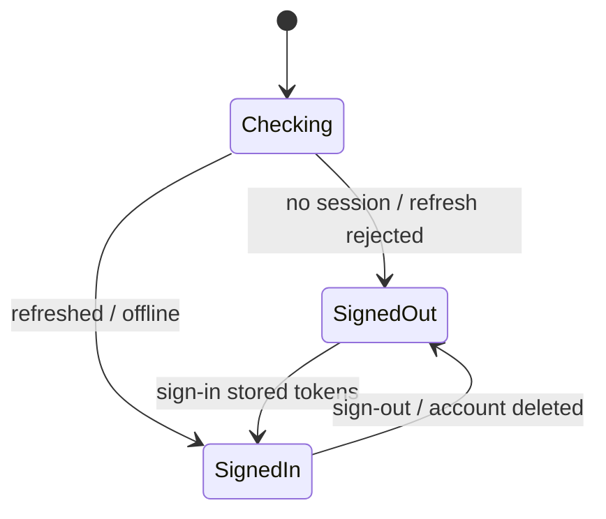

# Sign-in and session
**Last verified**: 2026-11-22 (kmp_cognito_login STORY-1 / PLIUS-34; app part)
**Scope**: the sign-in screen, the session kept across launches, sign-out and "Delete account", on Android and iOS.

## Summary
Both apps open on a sign-in screen until someone signs in. The user signs in with Google or Apple through the Cognito
user pool's managed login, in the system browser (a Custom Tab on Android, an `ASWebAuthenticationSession` on iOS).
Debug builds sign in to the dev stack, Release builds to the prod stack. The tokens stay in secure storage, so the
next launch skips sign-in. The device list has an account menu with "Sign out" and "Delete account".

The flow is shared Kotlin. `core/domain` has the use cases over two ports: `Authenticator` (Cognito) and
`TokenStore` (secure storage). `core/presentation` has `SignInViewModel` and `SessionViewModel`. `core/data` holds
`CognitoAuthenticator`, plain HTTPS to the managed login and the user pool API (Ktor, no AWS SDK), plus the platform
browser and storage. Each app only draws the states: Compose in `feature/signin`, SwiftUI in `iosApp`.

The Cognito user pool, its app client and the identity providers are set up in the private repository
`rsetkus/pliuskis-backend` (Terraform, two stacks: dev and prod). This repository holds no infrastructure code and no
real pool ID. Sign-in does not change MQTT yet: Android Release still connects with the shared certificate, and iOS
and Android Debug use the LAN broker.

### How it works
1. **Launch.** The app creates one `SessionViewModel`: on Android in `PliuskisApp` (the activity owns it), on iOS in
   `LiveSession` (the root view owns it). Its `state` starts as `Checking`. `RestoreSessionUseCase` reads the stored
   tokens. With none, the state is `SignedOut`. Otherwise Cognito refreshes the stored refresh token and the new
   tokens are stored. If Cognito rejects the refresh token (`invalid_grant`, an expired or revoked token), the stored
   session is removed and the state is `SignedOut`. Any other failure, for example no network, keeps the session, so
   an offline launch stays signed in. After the check, `ObserveSessionUseCase` follows the stored session:
   `SignedIn` while tokens are stored.
2. **Screens.** `Checking` shows progress. `SignedOut` shows sign-in, `SignedIn` the device list. On Android,
   `PliuskisAppState.showScreenFor` makes the destination the only entry of the back stack. So Back from the device
   list closes the app, and leaving the device list destroys its back stack entry, which clears the device list and
   control ViewModels. On iOS, `LiveSession` swaps the views; the released screens' `IosViewModelStoreOwner`s clear
   their ViewModels.
3. **Sign-in.** `SignInViewModel.signIn(provider)` moves to `SigningIn(provider)` and calls `SignInUseCase` once. A
   second choice while `SigningIn` is ignored, and both buttons are disabled. `CognitoAuthenticator.signIn` makes a
   PKCE pair and an OAuth `state`. It opens `https://<domain>/oauth2/authorize` with `identity_provider=Google` or
   `SignInWithApple`, and the scopes `openid email aws.cognito.signin.user.admin`. The browser returns the redirect
   URI with a code. The code is exchanged at `/oauth2/token` (with `code_verifier`) for ID, access and refresh
   tokens, which are stored. The stored session then moves `SessionViewModel` to `SignedIn`.
   - A closed browser or Apple sheet is `SignInCancelledException`: back to `SignedOut`, no error.
   - A request that can't reach Cognito is `AuthNetworkException`: `Error(NETWORK)`.
   - Anything else is `Error(FAILED)`.
   - From `Error`, either button starts a new sign-in. The states hold meanings; each app maps them to its text.
4. **Sign-out.** "Sign out" in the account menu calls `SessionViewModel.signOut()`. `SignOutUseCase` revokes the
   refresh token at `/oauth2/revoke` once, then removes the stored session, even when the revoke failed. The state
   becomes `SignedOut`.
5. **Delete account.** "Delete account" shows a confirmation (`AccountDeletionState.Confirming`). Cancel calls
   nothing. Delete calls `DeleteAccountUseCase`: Cognito `DeleteUser` on `cognito-idp.<region>.amazonaws.com` with
   the stored access token, then the stored session is removed and the app shows sign-in. If `DeleteUser` fails, the
   user stays signed in and the state is `DeleteFailed` ("Try again" or "Cancel").

**Configuration.** Seven keys, real values only in gitignored files (`secrets.properties`, `Secrets.xcconfig`) and,
for the iOS release, in the GitHub environment `release`:

| Key | Read by | Android Debug | Android Release | iOS |
|---|---|---|---|---|
| `COGNITO_USER_POOL_ID`, `COGNITO_APP_CLIENT_ID`, `COGNITO_LOGIN_DOMAIN`, `COGNITO_REDIRECT_URI` | sign-in | `DEBUG_COGNITO_*` (dev stack) | `COGNITO_*` (prod stack) | `COGNITO_*[config=Debug]` (dev), `[config=Release]` (prod), into Info.plist `Cognito*` |
| `COGNITO_IDENTITY_POOL_ID`, `AWS_REGION`, `AMAZON_IOT_ENDPOINT` | the Release MQTT connection over Cognito (not read yet) | none | `COGNITO_*`, `AWS_REGION`, `AMAZON_IOT_ENDPOINT` | `[config=Release]` |

`default.secrets.properties` and `Secrets.template.xcconfig` list every key with dummy values. With dummy values the
apps build and show the sign-in screen, but sign-in fails (the managed login domain doesn't exist).

## Key files
- Ports and use cases: `core/domain/.../core/auth/` (`Authenticator`, `TokenStore`, `RestoreSessionUseCase`,
  `ObserveSessionUseCase`, `SignInUseCase`, `SignOutUseCase`, `DeleteAccountUseCase`; bound in `coreModule`)
- ViewModels and states: `core/presentation/.../presentation/signin/` (`SignInViewModel`, `SignInState`) and
  `.../presentation/session/` (`SessionViewModel`, `SessionState`, `AccountDeletionState`)
- Cognito client: `core/data/.../data/auth/CognitoAuthenticator.kt` (+ `Pkce.kt`, `SignInSettings.kt`,
  `StoredSessionTokenStore.kt`)
- Android: `core/data/src/androidMain/.../auth/` (`KeystoreSessionStorage`, `CustomTabsAuthorizationBrowser`,
  `SignInBrowserActivity`, `SignInRedirectActivity`; bound in `androidDataModule`),
  `app/.../signin/SignInSettingsModule.kt`, `app/src/main/AndroidManifest.xml` (the two activities), `feature/signin` (`SignInScreen`, `AccountMenu`,
  `AccountDeletionDialog`, `signInModule`, `SIGN_IN_ROUTE`), `app/.../ui/PliuskisApp.kt` and `PliuskisAppState.kt`
- iOS: `core/data/src/iosMain/.../auth/` (`KeychainSessionStorage`, `WebAuthenticationBrowser`; bound in
  `iosDataModule`), `shared/.../SignInConfiguration.kt` and the factories `createSignInViewModel()`,
  `createSessionViewModel()` in `SharedEntryPoint.kt`, `iosApp/iosApp/` (`LiveSession.swift`, `LiveSignIn.swift`,
  `SignInScreen.swift`; `AccountMenu` and the delete alerts in `LiveSession.swift`, shown in the toolbar of
  `LiveDeviceList.swift`)
- Tests: `Story1SessionViewModelTest`, `Story1SignInViewModelTest`, `CognitoAuthenticatorTest`,
  `Story1SignInScreenSnapshotTest`, `Story1SignInScreenTest`, `Story1SignInNavigationTest`, `Story1SignInUITests`,
  `Story1SignInSharedApiTest`, `Story1SignInSwiftTests`

## Gotchas & decisions
- **No token in plain storage or logs.** Android encrypts the session with an AES-GCM key in the Android Keystore and
  writes it to `noBackupFilesDir/session.bin`: not SharedPreferences, not in backups. iOS keeps it in one Keychain
  item (`lt.setkus.pliuskis.session`, after first unlock, this device only), not UserDefaults. `AuthTokens.toString`
  is redacted. Ktor has no logging plugin, and no error message carries a token, a code or a URL. A session that can't
  be decrypted or read is removed, and the user signs in again.
- **Managed login over plain HTTPS, not an SDK.** The app client is public (no secret) and uses PKCE and an OAuth
  `state` check. `DeleteUser` needs the `aws.cognito.signin.user.admin` scope, so the app client in pliuskis-backend
  must allow `openid`, `email` and that scope, and token revocation must stay on.
- **Apple button.** iOS draws Apple's standard `ASAuthorizationAppleIDButton` as the label of a SwiftUI button, which
  is the accessibility element, so `disabled` reaches VoiceOver and the UI tests. Apple sign-in runs through the
  managed login (`identity_provider=SignInWithApple`), not the native Apple ID flow, so both providers give Cognito
  users. SwiftUI's `SignInWithAppleButton` would start the native flow, so it isn't used.
- **Redirect URI.** Android's `SignInRedirectActivity` gets its intent filter scheme from the build type's redirect
  URI (`signInRedirectScheme` manifest placeholder, read in `app/build.gradle.kts` from the secrets files).
  `ASWebAuthenticationSession` takes the scheme from the redirect URI at run time, so iOS registers no URL type. An
  xcconfig value can't contain `//` (comment), so `Secrets.xcconfig` writes it `lt.setkus.pliuskis:/$()/signin`. The
  release workflow does the same.
- **Android browser flow (AppAuth pattern).** `SignInBrowserActivity` (`singleTask`, translucent) opens the Custom Tab
  on its first resume. When it resumes again, it either has the redirect, brought back by `SignInRedirectActivity`
  with `CLEAR_TOP`, or the user closed the tab (cancelled). `PendingAuthorization` is the one waiting sign-in; a new
  sign-in answers an old one as cancelled.
- **Offline launch stays signed in.** Only a rejected refresh token signs the user out at launch; a failed refresh for
  any other reason keeps the stored tokens (the next refresh may succeed).
- **Sign-out does not touch MQTT yet.** The MQTT client is an app-wide singleton on the shared certificate or LAN
  broker, not tied to the identity. Reconnecting under the signed-in identity belongs to the Cognito MQTT connection
  (PLIUS-35).
- **Tests use a fake signed-in session.** Android UI tests override `Authenticator` and `TokenStore` in Koin
  (`loadKoinModules`, as in `AppSignInFakes.kt`). iOS UI tests use `-uiTestScenario`: the `signIn*` scenarios show the
  sign-in screen in a fixed state, `signedInLive` the live device list without sign-in, and the device and control
  scenarios skip the session. `initShared` reads the sign-in settings from Info.plist, so a test process without them
  gets an incomplete `SignInSettings`, and sign-in fails with `Error(FAILED)`.
- **XcodeGen and the team ID.** `xcodegen generate` copies `DEVELOPMENT_TEAM` of the local `Secrets.xcconfig` into
  `project.pbxproj`. Generate with the template's empty value (or without the file) so no team ID is committed.
