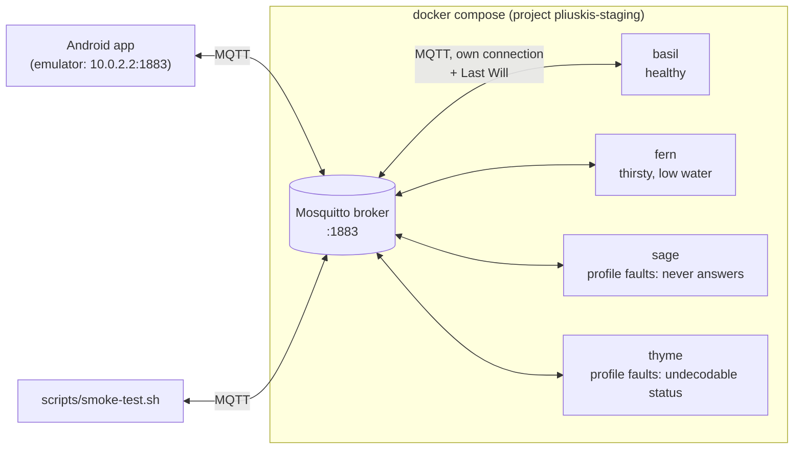
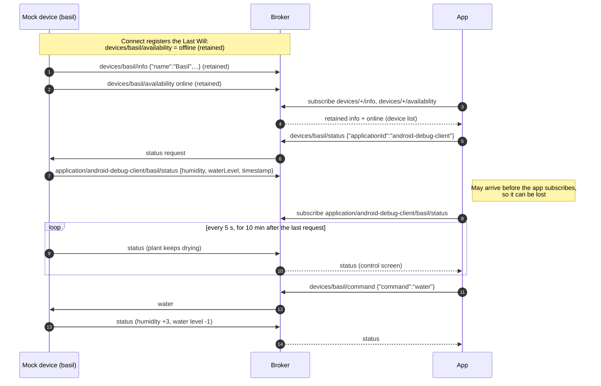
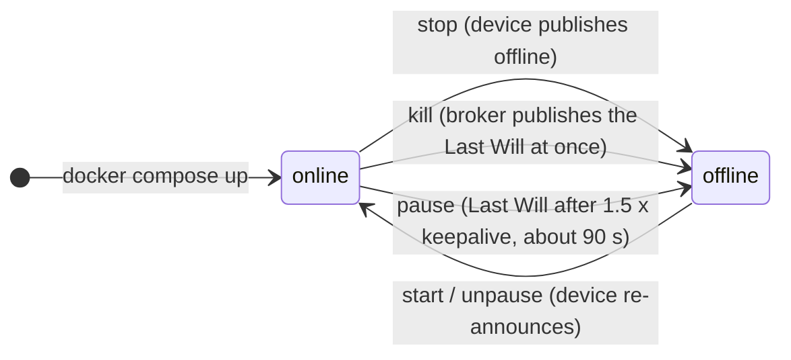
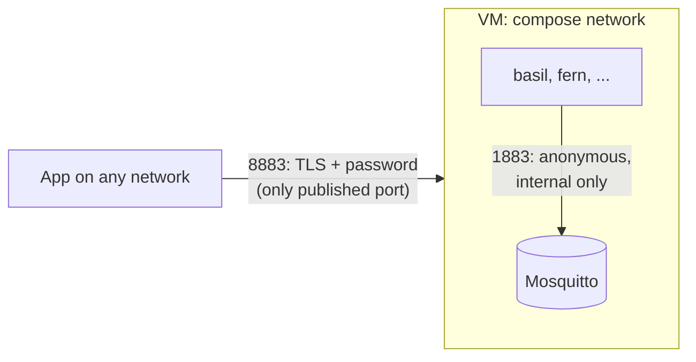

# Pliuškis staging

A staging environment for the [Pliuškis](https://github.com/rsetkus/pliuskis) Android app: an MQTT broker plus
simulated plant devices that speak the app's whole MQTT contract. That covers discovery, online/offline, status
replies and the water command. You can exercise every app screen, including the unhappy paths, without a Raspberry
Pi Pico on the desk.

It is deliberately separate from the app repository. The two sides meet only through the broker, exactly like the
real device firmware ([pico-pliuskis](https://github.com/rsetkus/pico-pliuskis)) and the app.



| Path | What |
|---|---|
| `docker-compose.yml` | Broker + device fleet, for a dev machine or LAN |
| `docker-compose.remote.yml` | Overlay for a VM: TLS + passwords for apps, devices stay internal |
| `mosquitto/` | Broker configs |
| `mock-device/` | The simulated device: a standalone Kotlin/JVM app (Gradle) |
| `scripts/smoke-test.sh` | Plays the app against a running stack and checks the contract end to end |

## Using staging, step by step

### 1. Install the prerequisites (once)
- **Docker** with Compose v2.24 or later. Check with `docker compose version`. Docker Desktop on macOS or Windows
  already includes it.
- **Android Studio** with an emulator, to run the app.
- Optional: **mosquitto-clients** (`brew install mosquitto` or `sudo apt install mosquitto-clients`), for the smoke
  test and for looking at MQTT traffic yourself.

No JDK is needed: the mock device image compiles itself inside Docker.

### 2. Get the project
Put the project in `~/projects` from the archive:
```sh
mkdir -p ~/projects
tar xzf ~/Downloads/pliuskis-staging.tar.gz -C ~/projects
cd ~/projects/pliuskis-staging
```
If you cloned it from git instead, `cd` into the clone. Run every command below from this folder.

### 3. Start the broker and the devices
```sh
docker compose up -d --build
```
- The first run takes a few minutes, because it downloads the images and builds the mock device. Later runs take
  seconds.
- This starts the broker on port 1883, plus two devices: `basil` (healthy) and `fern` (thirsty, low on water).

### 4. Check that it is running
```sh
docker compose ps
```
- `broker` should be `running (healthy)`, and `basil` and `fern` should be `running`.
- Look at what the devices are doing:
  ```sh
  docker compose logs basil fern
  ```
  Each should show `Connected; announcing on devices/<id>/info`.
- Optional, if you installed mosquitto-clients: run the smoke test, which plays the app and checks the whole contract:
  ```sh
  scripts/smoke-test.sh
  ```
  It should end with `Smoke test passed`.

### 5. Connect the app
1. Start an Android emulator.
2. Open the `pliuskis` project in Android Studio and run the **debug** build on the emulator.
   - The debug build already connects to `10.0.2.2:1883`, which the emulator maps to port 1883 on your computer.
     So it reaches this broker without any app setting.
   - Physical phones can't connect yet, because the app can't be pointed at another address.
3. The device list shows **Basil** and **Fern**, both online.

### 6. Use the app against the mock devices
- **Open Basil:** the control screen shows "I am good…" and "More than enough water."
  - The first values can take up to 5 s to appear. The app asks for status before it starts listening for the answer,
    so the device's first reply can be missed; the device repeats it every 5 s.
- **Open Fern:** both warnings show: "I am thirsty!…" and "Running low of water."
- **Tap Add water on Fern:** humidity rises by 3 and the water level drops by 1, and the screen updates within a
  moment.
  - The thirst warning disappears once humidity reaches 5. Fern keeps drying, so you may need to tap twice.
  - Fern's reservoir only holds two waterings; after that, Add water does nothing. Refill it with
    `docker compose restart fern`.
- **Wait on a screen:** the soil keeps drying at 0.5 per minute, and the "Updated at" time refreshes every 5 s.

### 7. Try the unhappy paths
- **Misbehaving devices:** start the two extra devices:
  ```sh
  docker compose --profile faults up -d --build
  ```
  - **Sage** appears online, but its control screen stays on Loading, because it never answers.
  - **Thyme**'s control screen shows Error, because its status has a field the app doesn't accept.
- **Device failures:** watch the device list while you run these:

  | Run | Simulates | App shows Basil as |
  |---|---|---|
  | `docker compose stop basil` | clean shutdown | offline, immediately |
  | `docker compose kill basil` | power cut | offline, immediately (the broker's Last Will) |
  | `docker compose pause basil` | Wi-Fi hangs | offline after about 90 s |
  | `docker compose start basil` (after stop/kill) or `docker compose unpause basil` (after pause) | device comes back | online again |

- **Broker restart:** `docker compose restart broker`. The app and the devices reconnect, and the device list
  recovers.

### 8. Reset or stop
- **Refill a device:** `docker compose restart fern`. Each restart starts a device with its initial values again.
- **Stop everything:** `docker compose down`. The broker keeps its list of known devices for the next start.
- **Stop everything and wipe the broker:** `docker compose down -v`. Use this if the app lists devices that no longer
  exist.

### Optional: watch the raw MQTT traffic
With mosquitto-clients installed, this prints every message between the app and the devices:
```sh
mosquitto_sub -h localhost -v -t 'devices/#' -t 'application/#'
```

## The devices

| Device | Humidity | Water level | What the app shows |
|---|---|---|---|
| `basil` | 8 | 9 | Healthy: no warnings |
| `fern` | 3 | 2 | "I am thirsty!" and "Running low of water." |
| `sage` (`faults`) | 8 | 10 | Listed and online, but the control screen stays in Loading: it never answers |
| `thyme` (`faults`) | 8 | 10 | Control screen shows Error: its status has an extra `battery` field the app rejects |

Both values use the firmware's 0..10 scale, where 10 = wet or full. The app warns below 5.
- The soil dries at 0.5 per minute.
- **Add water** raises humidity by 3 (capped at 10) and uses 1 unit of water.
- With an empty reservoir, watering does nothing.

`docker compose restart <device>` resets a device to its initial values.

## The MQTT contract
The app's code is the source of truth. Discovery is documented in the app repo's
[`docs/features/device-discovery.md`](https://github.com/rsetkus/pliuskis/blob/master/docs/features/device-discovery.md).
The mock implements exactly this:

| Topic | Direction | Retained / QoS | Payload |
|---|---|---|---|
| `devices/{id}/info` | device → app | retained, QoS 1 | `{"name":"Basil","deviceId":"basil","type":"plant"}` |
| `devices/{id}/availability` | device → app | retained, QoS 1 | `online` / `offline` (also the device's Last Will) |
| `devices/{id}/status` | app → device | – | `{"applicationId":"<app's MQTT client id>"}` |
| `application/{applicationId}/{id}/status` | device → app | QoS 1 | `{"humidity":8.0,"waterLevel":9.0,"timestamp":{"epochSeconds":1760000000,"nanosecondsOfSecond":123}}` |
| `devices/{id}/command` | app → device | – | `{"command":"water"}` |



**How a device behaves:**
- **On every connect or reconnect** it publishes the retained `info` and then the retained `online`, the same birth
  sequence as the firmware. The broker holds an `offline` Last Will for the device.
- **On a status request** it answers right away on the requester's reply topic. It then keeps publishing there every
  5 s (the firmware's check-in interval) for 10 minutes after that app's latest request. The app sends its request
  before it subscribes to the reply topic, so the first answer can be lost; the next one arrives within 5 s.
- **On `water`** it updates the plant and pushes the new status to every app that asked recently.
- **On SIGTERM** it publishes retained `offline`, then disconnects cleanly. A clean disconnect suppresses the Last Will.

## Simulating failures
Standard Docker commands map onto the real failure modes, so no custom tooling is needed:



| Command | Real-world equivalent | What the app sees |
|---|---|---|
| `docker compose stop basil` | Device shut down cleanly | `offline` immediately (published by the device) |
| `docker compose kill basil` | Power cut | `offline` immediately (the broker's Last Will) |
| `docker compose pause basil` | WiFi hangs, TCP stays open | `offline` after 1.5 × keepalive, so about 90 s (Last Will) |
| `docker compose start basil` / `unpause basil` | Device comes back | Re-announces itself `online` |
| `docker compose restart broker` | Broker restart | Devices reconnect and re-announce; retained state survives |

## Configuration
Each device container is configured through environment variables. A device validates them on start and exits with
code 2 and a readable message if one is wrong.

| Variable | Default | Meaning |
|---|---|---|
| `DEVICE_ID` | required | Topic segment and MQTT client id. Allowed characters: letters, digits, `_` and `-`. |
| `DEVICE_NAME` | the id | Name shown in the app |
| `DEVICE_TYPE` | `plant` | The app knows `plant`; anything else shows as unknown |
| `MQTT_HOST` / `MQTT_PORT` | `localhost` / `1883` | Broker address (`broker` inside compose) |
| `MQTT_KEEPALIVE_SECONDS` | `60` | Same as the firmware; the Last Will fires after 1.5 × this without traffic |
| `HUMIDITY` / `WATER_LEVEL` | `8` / `10` | Initial values, 0..10 |
| `DRYING_PER_MINUTE` | `0.5` | Humidity lost per minute |
| `STATUS_INTERVAL_SECONDS` | `5` | Simulation tick and status republish interval |
| `FAULT` | `none` | `silent` or `malformed-status` |

To add a device, copy one of the services in `docker-compose.yml` and give it a new `DEVICE_ID`.

To run one without Docker, start a broker first (for example `mosquitto -p 1883`), then:
```sh
cd mock-device
./gradlew installDist
DEVICE_ID=basil DEVICE_NAME=Basil build/install/mock-device/bin/mock-device
```

## Run it on a VM
`docker-compose.remote.yml` changes three things:
- The broker accepts apps only on **8883, with TLS and a username/password**.
- Port 1883 stays inside the compose network, where the devices use it anonymously.
- Every service restarts unless stopped.



Steps:

1. Copy this folder to the VM. It needs Docker only.
2. Create the app credentials. Mosquitto runs as uid 1883 and must be able to read the file:
   ```sh
   docker run --rm -v "$PWD/mosquitto:/m" eclipse-mosquitto:2.0 mosquitto_passwd -c -b /m/passwd tester '<password>'
   sudo chown 1883:1883 mosquitto/passwd && sudo chmod 600 mosquitto/passwd
   ```
3. Add a publicly trusted certificate for the VM's DNS name, for example from Let's Encrypt. Let's Encrypt keeps
   `privkey.pem` readable only by root, so copy it:
   ```sh
   mkdir -p mosquitto/certs
   sudo cp /etc/letsencrypt/live/<domain>/{fullchain,privkey}.pem mosquitto/certs/
   sudo chown -R 1883:1883 mosquitto/certs && sudo chmod 600 mosquitto/certs/privkey.pem
   ```
   After a renewal, copy the files again and run `docker compose restart broker`.
4. Start:
   ```sh
   docker compose -f docker-compose.yml -f docker-compose.remote.yml up -d --build
   ```
5. Open TCP 8883 in the VM's firewall.

`mosquitto/passwd` and `mosquitto/certs/` are git-ignored.

## Development
```sh
cd mock-device
./gradlew test detekt ktlintCheck
```
- **Tests** (Kotest): config parsing, the exact JSON wire format (decoded the way the app decodes it), the plant model,
  the device behaviour on virtual time, and a round trip through an embedded broker (Moquette).
- **Lint:** detekt uses the app's rules (`config/detekt/detekt.yml`); ktlint follows the app's Kotlin code style.
- **CI:** `.github/workflows/ci.yml` runs the tests and lint, brings the stack up, runs the smoke test, and checks a
  clean shutdown.

`gradle/libs.versions.toml` pins the same Kotlin, HiveMQ client, kotlinx-serialization and kotlinx-datetime versions
as the app. Keep them in step, so the MQTT client and the JSON format behave exactly as they do in the app.

## Gotchas
- **The app decodes status strictly.** A status payload must have exactly `humidity`, `waterLevel` and `timestamp`,
  with the timestamp as an object. Any extra or missing key moves the app's control screen to Error, and status
  updates stop until the screen is reopened. That is what `thyme` demonstrates. Change the app and the devices
  together.
- **Ghost devices.** Discovery is retained, and the broker persists it in the `broker-data` volume. A device you remove
  from compose stays listed as offline. Clear it with `docker compose down -v`, or for a single device with
  `mosquitto_pub -r -n -t devices/<id>/info` and `mosquitto_pub -r -n -t devices/<id>/availability`.
- **The app's MQTT client id is fixed** (`android-debug-client` in debug builds). Two app instances with the same id on
  one broker keep disconnecting each other.
- **The smoke test waters `basil`,** which uses up its water. `docker compose restart basil` refills it.
- **The remote broker has no ACLs.** Anyone with the password can publish to any topic, including other devices'
  topics. That is fine for staging; don't reuse the setup for production.
